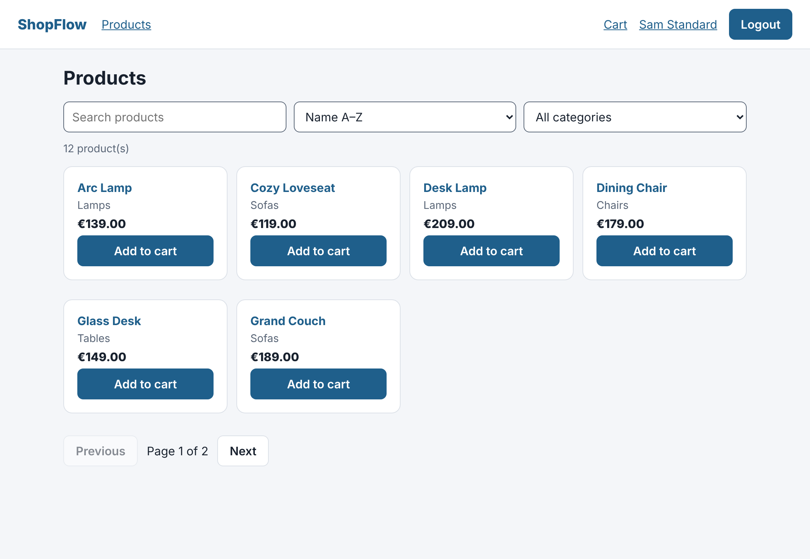

# ShopFlow — End-to-End Functional Test Automation

Advanced, production-style **functional QA automation** for a real e-commerce web
app, built with **Java 17 · Selenium 4 · TestNG · Maven · Allure**.

The repository contains two things that work together:

1. **`app/`** — *ShopFlow*, a small but complete full-stack e-commerce app
   (zero-dependency Node.js backend + vanilla-JS single-page frontend). It is
   the **system under test**: having full control of the app means the suite
   can reset and seed data over an API, so tests are fast and never flaky
   because of someone else's website.
2. **`src/test/`** — the Java/Selenium functional test framework that drives
   ShopFlow through the browser **and** its API.



---

## Why this project

Most portfolio Selenium projects click through a public demo site and hope it
stays up. This one is built the way a real QA engineer works:

- **Deterministic data.** The app exposes a test-only reset/seed API. Every test
  starts from an identical, known state — no leftovers, no ordering
  dependencies.
- **Two layers of testing.** Fast **API tests** pin down the backend contract
  (auth, roles, validation); **UI tests** prove the complete user journey.
- **Stable by design.** Explicit waits only (no `Thread.sleep`), stable
  `data-test` locators, a Page Object Model, and one controlled retry for
  infrastructure blips.
- **Parallel-safe.** A `ThreadLocal` WebDriver and per-test data reset let the
  suite run methods in parallel, locally or on a Selenium Grid.
- **CI + reporting.** GitHub Actions runs the suite on a **Chrome + Firefox**
  matrix and publishes an **Allure** report to GitHub Pages.

---

## Architecture

```
shopflow-qa/
├── app/                         # System under test (Node.js, no deps)
│   ├── src/                     #   server.js, store.js, data.js
│   └── public/                  #   index.html, app.js  (SPA)
├── src/test/java/com/shopflow/
│   ├── config/                  # Config (sys-prop > env > file), Browser, Users
│   ├── driver/                  # DriverFactory — ThreadLocal, local or Remote
│   ├── api/                     # ApiClient — reset/seed + API-level tests
│   ├── pages/                   # Page Objects (one per screen)
│   ├── components/              # Header component (shared across pages)
│   ├── data/                    # TestData + TestNG DataProviders
│   ├── listeners/               # Retry + screenshot-on-failure listeners
│   ├── utils/                   # Waits, screenshot helper
│   └── tests/                   # The test classes (BaseTest + suites)
├── suites/                      # TestNG suites: smoke / regression / parallel
├── docker/                      # Selenium Grid (docker-compose)
├── docs/                        # Test plan + bug-report template
└── .github/workflows/ci.yml     # CI: browser matrix + Allure to Pages
```

### Key design decisions

| Concern | Approach |
|---|---|
| Locators | `data-test` attributes only — decoupled from styling/text/i18n |
| Page objects | Fluent, return the next page; tests contain **no** raw locators |
| Waiting | Explicit `WebDriverWait`; SPA in-place re-renders handled with staleness waits |
| Test data | Arranged via `ApiClient` (reset + seed), not by clicking through the UI |
| Isolation | Fresh browser per test (`ThreadLocal`) + API reset in `@BeforeMethod` |
| Config | `-Dkey=…` system property **>** `KEY` env var **>** `config.properties` |
| Cross-browser | Chrome / Firefox / Edge via `-Dbrowser`; Selenium Manager finds drivers |
| Grid | `-DremoteUrl=…` switches the same tests to `RemoteWebDriver` |
| Flakiness | `RetryAnalyzer` (1 retry) applied globally by an `IAnnotationTransformer` |
| Reporting | Allure `@Epic/@Feature/@Story/@Severity/@Step`; screenshot attached on failure |

---

## Running it

### Prerequisites
- **JDK 17+** and **Maven**
- **Node.js 20+** (to run the app)
- A local **Chrome** or **Firefox** (Selenium Manager downloads the driver automatically)

### 1. Start the app
```bash
cd app
npm start            # serves ShopFlow on http://localhost:5000
```
Leave it running in one terminal (no `npm install` needed — the app has no
dependencies).

### 2. Run the tests (in another terminal)
```bash
# Smoke suite (fast, critical paths)
mvn test -Dsuite=suites/smoke.xml

# Full regression suite
mvn test -Dsuite=suites/regression.xml

# Regression in parallel (4 browsers at once)
mvn test -Dsuite=suites/parallel.xml

# Pick a browser / show the browser window
mvn test -Dsuite=suites/smoke.xml -Dbrowser=firefox -Dheadless=false
```

### 3. See the report
```bash
mvn allure:serve      # opens the Allure report in your browser
```

### Run against Selenium Grid (optional)
```bash
docker compose -f docker/docker-compose.grid.yml up -d
mvn test -Dsuite=suites/parallel.xml \
         -DremoteUrl=http://localhost:4444/wd/hub \
         -DbaseUrl=http://host.docker.internal:5000
docker compose -f docker/docker-compose.grid.yml down
```
Watch a live browser at <http://localhost:7900> (password `secret`).

---

## What's covered

| Area | Examples |
|---|---|
| **Auth & roles** | valid login, 6 invalid/locked variants (data-driven), logout, admin-only navigation |
| **Catalogue** | full page, 4 sort orders each verified sorted, search + empty state, 4 category filters, pagination with no overlap, product detail |
| **Cart** | add from list & detail, accumulation, quantity → subtotal, remove clears badge |
| **Checkout** | full purchase → `ORD-…`, totals = subtotal + 19% tax, 3 validation cases, cancel keeps cart |
| **Account** | edit persists across reload, invalid email & empty name rejected |
| **Admin** | create/delete product, validation, customer access denied |
| **API** | token on login, 403 locked, 401 wrong password, catalogue count/filter, checkout 400, admin 403/201 |

Full strategy, entry/exit criteria and the case list: **[docs/TEST_PLAN.md](docs/TEST_PLAN.md)**.

---

## A note on parallel execution

The framework is **parallel-ready** — each test gets its own browser via a
`ThreadLocal` WebDriver. But `suites/parallel.xml` is only safe to actually run
concurrently when **each worker has isolated application state**.

The demo app keeps a single, global in-memory store, and each test resets it
(`POST /api/test/reset`) before running. Run against **one** app instance in
parallel, one worker's reset wipes the session/cart another worker is mid-test
with → flaky, order-dependent failures. That's a property of the system under
test, not the framework. To parallelise for real you'd give each worker its own
state (an app instance per worker, or a unique user per worker with a per-user
reset). **Against a single shared app, run the suites serially** (`smoke.xml` /
`regression.xml`) — which is how CI runs them.

---

## Test accounts (seeded)

| Username | Password | Role |
|---|---|---|
| `standard_user` | `Pass123!` | customer |
| `admin_user` | `Admin123!` | admin |
| `locked_user` | `Pass123!` | locked (login blocked) |

---

## Tech stack

Java 17 · Selenium 4 (Selenium Manager) · TestNG · Maven (Surefire) · Allure ·
Jackson · Page Object Model · Selenium Grid · GitHub Actions · Node.js (SUT).
